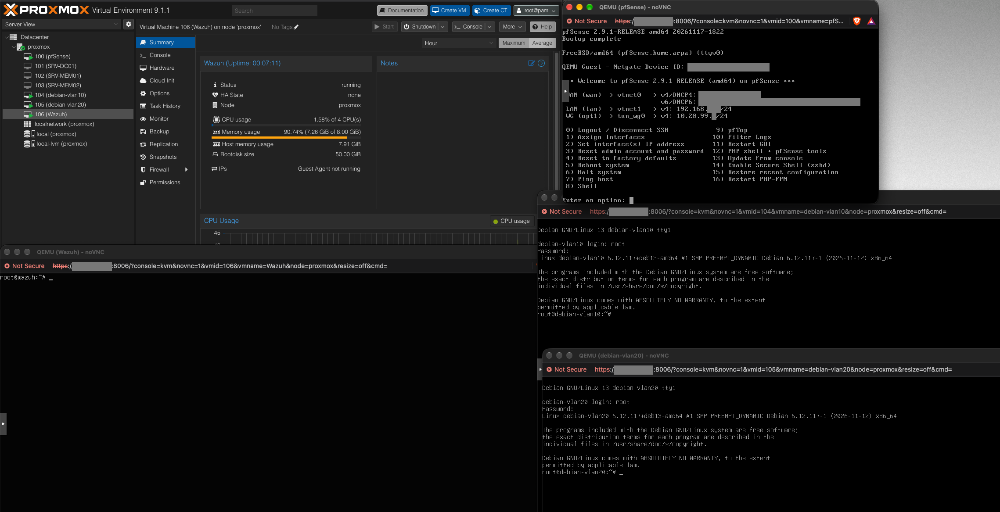
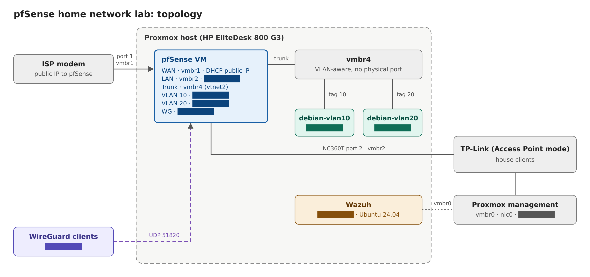

# pfSense-Home-Network-Lab
This lab demonstrates pfSense running as the router for a home network, virtualized on a Proxmox host. Features such as VLAN segmentation, a zone-style firewall policy, WireGuard, and Wazuh SIEM monitoring are included.



**Performed in lab**
- Routing and firewalling with pfSense (WAN/LAN, NAT, stateful rules)
- 802.1Q VLANs and router-on-a-stick on a VLAN-aware Linux bridge
- Zone-based firewall design implemented on an interface-based firewall
- DHCP scopes, static mappings and local DNS
- WireGuard remote-access VPN with least-privilege rules
- SIEM integration: pfSense syslog and Wazuh agents

## Table of contents
1. [Hardware](#hardware)
2. [Architecture](#architecture)
3. [Build Walkthrough](#build-walkthrough)
4. [Verification](#verification)

# Hardware


| Component | Details | Role |
| --- | --- | --- |
| Host | HP EliteDesk 800 G3 MT, Intel i7-7700, 16 GB RAM, 256 GB NVMe | Proxmox VE hypervisor |
| Extended NIC | HP NC360T dual-port gigabit | pfSense WAN (port 1) and LAN (port 2) |
| Built-in NIC | Intel gigabit | Proxmox management |
| Access Point | Home router (TP-Link) changed to Access Point mode | Wi-Fi for the home |
| Modem | ISP-provided | Public IP handed to pfSense |

## Cabling
| Physical port | Proxmox bridge | Connects to |
| --- | --- | --- |
| NC360T port 1 | `vmbr1` | Modem (pfSense WAN) |
| NC360T port 2 | `vmbr2` | Access Point (pfSense LAN) |
| Onboard NIC | `vmbr0` | TP-Link (Proxmox management, `192.168.0.50`) |

### Required to rebuild
| Requirement | Minimum | Why |
| --- | --- | --- |
| Physical NICs | 2 minimum, 3 recommended | pfSense is the front of the network, so it needs one WAN and one LAN port. A third NIC keeps Proxmox management reachable even if pfSense is down |
| NIC brand | Intel | Intel-based NICs are widely regarded as having the best driver support in pfSense |
| RAM | 16 GB with all features | See the budget below |
| Storage | Around 100 GB | pfSense 32 GB, each Debian VM 8 GB (there are two), Wazuh 50 GB |
| Access Point | Any router that supports Access Point mode; otherwise a dedicated access point can be used | pfSense performs the routing and DHCP leasing; the AP only provides Wi-Fi connectivity for the home |

### RAM budget
| VM | RAM | Notes |
| --- | --- | --- |
| pfSense | 3 GB | More than enough to run the firewall rules and WireGuard |
| `debian-vlan10` / `debian-vlan20` | 1 GB each | Debian is a lightweight distro, so this is enough to run |
| Wazuh | 8 GB | Indexer, server and dashboard on one VM |
| Proxmox host | ~1 - 2 GB | |
| **Total** | **~14 GB of 16 GB** | |

Alternatives: instead of a desktop like this one, a mini PC with two or more built-in NICs could be used to achieve the same lab.

# Architecture
### Topology


### Addressing
| Network | pfSense interface | Bridge | Subnet | Gateway | DHCP range |
| --- | --- | --- | --- | --- | --- |
| WAN | WAN (`vtnet0`) | `vmbr1` | ISP-assigned public IP | ISP | client |
| LAN | LAN (`vtnet1`) | `vmbr2` | `192.168.x.0/24` | `192.168.x.x` | .75 - .253 |
| VLAN 10 | VLAN10 (`vtnet2.10`) | `vmbr4` | `10.20.10.x/24` | `10.20.10.x` | .100 - .199 |
| VLAN 20 | VLAN20 (`vtnet2.20`) | `vmbr4` | `10.20.20.x/24` | `10.20.20.x` | .100 - .199 |
| WireGuard | WG (`tun_wg0`) | (tunnel) | `10.20.99.x/24` | `10.20.99.x` | static per peer |

### Static addresses (LAN .2 - .74 reserved)
| Host | IP | How |
| --- | --- | --- |
| TP-Link (AP) | `192.168.0.x` | DHCP static mapping, `archer.home.arpa` |
| Mesh units | `192.168.0.x` | DHCP static mappings |
| Proxmox host | `192.168.0.50` | Static on host, DNS host override `proxmox.home.arpa` |
| Wazuh | `192.168.0.x` | Static on VM, DNS host override `wazuh.home.arpa` |

### Zones and policy
pfSense is an interface-based firewall: rules apply to traffic entering an interface, the first match wins, and new interfaces block everything by default. Zone-based firewalls instead write policy between groups of interfaces. This lab implements the zone model in pfSense with an interface group (`LAB`), whose rules are evaluated before per-interface rules.

| Zone | Members |
| --- | --- |
| OUTSIDE | WAN |
| TRUSTED | LAN |
| LAB | VLAN10 + VLAN20 (interface group `LAB`) |
| REMOTE | WG (WireGuard clients) |

### Policy
Rows are the source, columns are the destination.

| From \ To | Internet | House LAN | VLAN 10 | VLAN 20 | pfSense |
| --- | --- | --- | --- | --- | --- |
| House LAN | Allow | - | Allow | Allow | Allow (GUI) |
| VLAN 10 | Allow | Deny (except Wazuh TCP 1514-1515) | - | SSH + ping only | DNS + ping only |
| VLAN 20 | Allow | Deny (except Wazuh TCP 1514-1515) | Deny | - | DNS + ping only |
| WireGuard | - (split tunnel) | DNS, pfSense GUI, Proxmox GUI, ping | Deny | Deny | Through its LAN address only |
| Internet | - | Deny | Deny | Deny | Deny (except UDP 51820) |

# Build Walkthrough
Each phase below should be enough to reproduce the work shown in this lab.

## Phase 1: Cutover - pfSense becomes the main router


1. Proxmox bridges: `vmbr1` on NC360T port 1 (WAN), `vmbr2` on port 2 (LAN), both with no host IP. `vmbr0` keeps the host's management IP.
2. pfSense VM NICs: `net0` on `vmbr1`, `net1` on `vmbr2`, model VirtIO.
3. Before connecting anything, set the LAN from the pfSense console (option 2). The example values are shown next; feel free to change them: `192.168.0.1/24`, DHCP .75 - .253, keep the web GUI on HTTPS.
4. Switch the router to Access Point mode, or if you choose to use a physical access point, connect it to NC360T port 2 (`vmbr2`).
5. Move the modem cable to NC360T port 1, then power cycle the modem by unplugging it for 60 seconds. This is so the modem releases the old router's MAC address. Reboot pfSense so the WAN requests a new lease.
6. Connect NC360T port 2 to the TP-Link.
7. Verify from the Proxmox host shell, which works even without Wi-Fi or DHCP:

```bash
ping -c 4 192.168.x.x   # LAN path to pfSense
ping -c 4 8.8.8.8       # WAN routing
ping -c 4 google.com    # DNS
```


## Phase 2: Baseline settings
| Setting | Value |
| --- | --- |
| Hostname / domain | `pfSense` / `home.arpa` |
| WAN | DHCP from modem; Block private networks and Block bogons checked |
| Web GUI | HTTPS, LAN only; anti-lockout rule kept |
| Admin | Default passwords changed |
| Proxmox | pfSense VM Start at boot = Yes |

- Optional but helpful: back up the pfSense config (Diagnostics > Backup & Restore) and take snapshots of the pfSense VM itself in Proxmox. The config contains the WireGuard private key, so encrypt the backup.

## Phase 3: DHCP and DNS
- Static mappings (Services > DHCP Server > LAN): the AP and mesh units get reserved IPs.
- DNS Resolver (Services > DNS Resolver):
  - Register DHCP static mappings, so `archer.home.arpa` resolves automatically
  - Host overrides for static hosts: `proxmox.home.arpa`, `wazuh.home.arpa`
  - Network interfaces: All, so VLAN and VPN clients can query their gateway


## Phase 4: VLANs (router-on-a-stick)
1. Proxmox: Create > Linux Bridge `vmbr4` with no IP, no bridge ports and **VLAN aware** checked, then click **Apply Configuration**. Next step may not be needed, but the bridge might need the configuration below to properly apply

```
auto vmbr4
iface vmbr4 inet manual
        bridge-ports none
        bridge-stp off
        bridge-fd 0
        bridge-vlan-aware yes
        bridge-vids 2-4094
```

2. Proxmox: add a third NIC to the pfSense VM on `vmbr4`, VLAN tag blank, Firewall unchecked. Reboot pfSense from Proxmox; the NIC appears as `vtnet2`.
3. pfSense: Interfaces > Assignments > VLANs, create tags 10 and 20 on `vtnet2`. Assign both, enable them and set static IPs `10.20.10.x/24` and `10.20.20.x/24`. Leave `vtnet2` itself unassigned.
4. pfSense: enable DHCP on both VLAN tabs (.100 - .199).

The bridge has no physical port on purpose: tagged frames never reach the access point, which would drop or leak them.


## Phase 5: Zone rules
1. Alias `RFC1918` (Firewall > Aliases): `10.0.0.0/8`, `172.16.0.0/12`, `192.168.0.0/16`. These are the standard private IPv4 ranges.
2. Interface group `LAB` (Interfaces > Interface Groups): VLAN10 + VLAN20.

**Firewall > Rules > LAB** (top to bottom, first match wins)

| # | Action | Protocol | Destination | Port | Purpose |
| --- | --- | --- | --- | --- | --- |
| 1 | Pass | TCP/UDP | This Firewall | 53 | DNS |
| 2 | Pass | ICMP echo | This Firewall | - | Ping the gateway |
| 3 | Block (log) | any | This Firewall | any | No GUI/SSH from the lab |
| 4 | Pass | TCP | Wazuh (`192.168.0.x`) | 1514-1515 | Wazuh agents (must sit above rule 5) |
| 5 | Block (log) | any | LAN subnets | any | The lab cannot reach the house |
| 6 | Pass | any | NOT `RFC1918` | any | Internet only |

**Firewall > Rules > VLAN10**

| Action | Protocol | Source | Destination | Port |
| --- | --- | --- | --- | --- |
| Pass | TCP | VLAN10 subnets | VLAN20 subnets | 22 |
| Pass | ICMP echo | VLAN10 subnets | VLAN20 subnets | - |

**Firewall > Rules > VLAN20:** no pass rules, so VLAN 20 cannot start connections to VLAN 10.

Rules go on the interface where a connection starts. Replies are allowed automatically because pfSense is stateful.


## Phase 6: WireGuard remote access
**pfSense**
1. Install the `WireGuard` package (System > Package Manager).
2. Tunnel `tun_wg0`: listen port `51820`, generate keys, enable WireGuard.
3. Assign `tun_wg0` as interface `WG`: static `10.20.99.x/24`, MTU `1420`, MSS `1380`. Once the tunnel is assigned, its address lives on the interface page, not the tunnel.
4. Peers (one key pair per device, Dynamic Endpoint checked):

| Peer | Allowed IPs |
| --- | --- |
| Laptop | `10.20.99.x/32` |
| Phone | `10.20.99.x/32` (a different address than the laptop) |

5. WAN rule: pass UDP to WAN address, port 51820.
6. WG rules (source WG subnets; everything else is dropped):

| Destination | Port | Purpose |
| --- | --- | --- |
| pfSense LAN address | 53 | DNS |
| pfSense LAN address | 443 | pfSense GUI |
| Proxmox host | 8006 | Proxmox GUI |
| LAN subnet | ICMP echo | Ping for testing |

Leave the automatic `WireGuard` group tab empty, since group rules are processed first.

**Client config (split tunnel)**

```ini
[Interface]
PrivateKey = <generated on the device, never share with others>
Address = 10.20.99.x/32
DNS = <pfSense LAN address>

[Peer]
PublicKey = <pfSense tun_wg0 public key>
Endpoint = <home WAN IP>:51820
AllowedIPs = <LAN subnet>, <WireGuard subnet>
PersistentKeepalive = 25
```


## Phase 7: Debian test VMs
| Setting | `debian-vlan10` | `debian-vlan20` |
| --- | --- | --- |
| OS | Debian 13 | same |
| CPU / RAM / disk | 1 vCPU / 1 GB / 8 GB | same |
| Install network | `vmbr0` (internet for packages) | same |
| Lab network | `vmbr4`, VLAN tag 10 | `vmbr4`, VLAN tag 20 |

Installer choices: no desktop environment, only *SSH server* and *standard system utilities*. Install the test tools while the VMs are still on `vmbr0`, then move each NIC to `vmbr4` with its VLAN tag:

```bash
sudo apt install -y nmap netcat-openbsd curl dnsutils tcpdump qemu-guest-agent
```

## Phase 8: Monitoring with Wazuh
**VM:** Ubuntu Server 24.04 LTS, 4 vCPU, 8 GB RAM, 50 GB disk, static IP on `vmbr0`. Ubuntu's default LVM layout only uses part of the disk, so extend `ubuntu-lv` to the full size during the install.

**Install (all-in-one):**

```bash
curl -sO https://packages.wazuh.com/4.14/wazuh-install.sh && sudo bash ./wazuh-install.sh -a
```

The admin password is printed at the end of install, note it down somewhere it will still be needed

**pfSense syslog:** add this to `/var/ossec/etc/ossec.conf` (next to the existing `<remote>` block), then restart `wazuh-manager`:

```xml
<remote>
  <connection>syslog</connection>
  <port>514</port>
  <protocol>udp</protocol>
  <allowed-ips>PFSENSE_LAN_IP</allowed-ips>
</remote>
```

In pfSense: Status > System Logs > Settings > Remote Logging, source address LAN, remote server `<wazuh-ip>:514`, contents Firewall Events and System Events.

**Agents on the VLAN VMs:** deployed from the Wazuh dashboard (Deploy new agent, DEB amd64). The lab VMs are blocked from the house LAN, so a narrow exception (LAB rule 4: TCP 1514-1515 to the Wazuh VM) is placed above the house block. Port 1514 carries agent data and 1515 is used for enrollment.


# Verification
| # | From | Command | Expected |
| --- | --- | --- | --- |
| 1 | `debian-vlan10` | `ip -br a` | VLAN 10 address from DHCP |
| 2 | `debian-vlan10` | `ping -c3 <VLAN10 gateway>` | Replies |
| 3 | `debian-vlan10` | `dig debian.org` | Answer from the VLAN 10 gateway |
| 4 | `debian-vlan10` | `curl -I https://www.debian.org` | HTTP response |
| 5 | `debian-vlan10` | `ping -c3 <Proxmox host>` | No reply (house blocked) |
| 6 | `debian-vlan10` | `curl -k -m 5 https://<VLAN10 gateway>` | Timeout (no GUI from the lab) |
| 7 | `debian-vlan10` | `ping -c3 <vlan20 VM>` | Replies |
| 8 | `debian-vlan10` | `nmap -Pn -p 22,80,443 <vlan20 VM>` | 22 open, 80/443 filtered |
| 9 | `debian-vlan20` | `ping -c3 <vlan10 VM>` | No reply (VLAN 20 to 10 denied) |
| 10 | Laptop on home Wi-Fi | `ssh <user>@<vlan10 VM>` | Login prompt (house to lab allowed) |
| 11 | Laptop on hotspot + VPN | open `https://proxmox.home.arpa:8006` | Loads |
| 12 | Laptop on hotspot + VPN | `curl -k -m 5 https://<AP address>` | Timeout |
| 13 | Wazuh dashboard | Agents | Both VMs Active |
